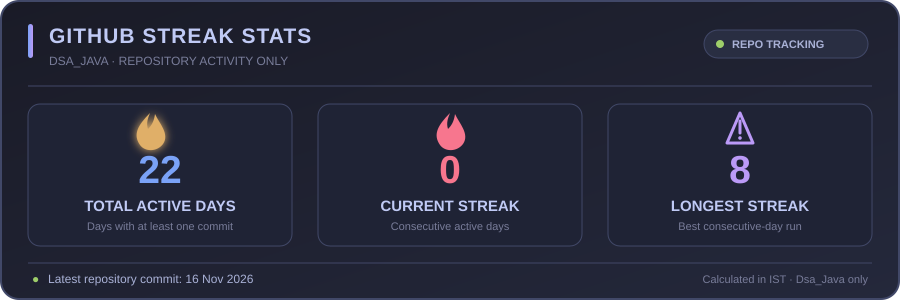

<!-- ===================== HERO ===================== -->

# Java DSA Practice

### A consistent journey of problem-solving with Java.

  
  
  
  

[Explore Problems](#-problem-library) · [Activity](#-coding-activity) · [Codeforces](./Codeforces/README.md) · [Repository](https://github.com/ChakaliPrakash/Dsa_Java)

---

## ✨ About This Repository

This repository tracks my hands-on practice in **Data Structures and Algorithms using Java**. It includes coding problems, pattern-based practice, and solutions developed while improving problem-solving skills.

| Focus area | What I practise |
|---|---|
| **Core patterns** | Arrays, strings, hashing, two pointers, sliding window |
| **Searching & sorting** | Binary search, sorting, search on answer |
| **Data structures** | Linked lists, stacks, queues, trees, graphs, heaps |
| **Problem-solving** | Greedy, recursion, backtracking, dynamic programming |
| **Java** | Clean implementation, collections, and complexity analysis |

## 🧭 Problem Library

  
  

Browse the automatically maintained problem index below. The DSA GitHub Actions workflow refreshes the generated section when qualifying Java solutions change.

<!-- AUTO-README:START -->

## 📚 Automatically Updated Problems

**Total problem folders:** 43

<!-- Problem links are generated from folders containing Java files. -->

- [Max Consecutive Ones Iii](./1046-max-consecutive-ones-iii)
- [Capacity To Ship Packages Within D Days](./1056-capacity-to-ship-packages-within-d-days)
- [Pascals Triangle](./118-pascals-triangle)
- [Triangle](./120-triangle)
- [Best Time To Buy And Sell Stock](./121-best-time-to-buy-and-sell-stock)
- [Longest Consecutive Sequence](./128-longest-consecutive-sequence)
- [Find Peak Element](./162-find-peak-element)
- [Kth Missing Positive Number](./1646-kth-missing-positive-number)
- [House Robber](./198-house-robber)
- [Count Good Numbers](./2050-count-good-numbers)
- [House Robber Ii](./213-house-robber-ii)
- [Contains Duplicate](./217-contains-duplicate)
- [Generate Parentheses](./22-generate-parentheses)
- [Find Subarrays With Equal Sum](./2480-find-subarrays-with-equal-sum)
- [Missing Number](./268-missing-number)
- [Search In Rotated Sorted Array](./33-search-in-rotated-sorted-array)
- [Find First And Last Position Of Element In Sorted Array](./34-find-first-and-last-position-of-element-in-sorted-array)
- [Search Insert Position](./35-search-insert-position)
- [Median Of Two Sorted Arrays](./4-median-of-two-sorted-arrays)
- [Split Array Largest Sum](./410-split-array-largest-sum)
- [Partition Equal Subset Sum](./416-partition-equal-subset-sum)
- [Longest Repeating Character Replacement](./424-longest-repeating-character-replacement)
- [Assign Cookies](./455-assign-cookies)
- [Max Consecutive Ones](./485-max-consecutive-ones)
- [Powx N](./50-powx-n)
- [Base 7](./504-base-7)
- [Single Element In A Sorted Array](./540-single-element-in-a-sorted-array)
- [Jump Game](./55-jump-game)
- [Unique Paths](./62-unique-paths)
- [Unique Paths Ii](./63-unique-paths-ii)
- [Sqrtx](./69-sqrtx)
- [Climbing Stairs](./70-climbing-stairs)
- [Intersection Of Two Sorted Arrays](./706-intersection-of-two-sorted-arrays)
- [Minimum Window Substring](./76-minimum-window-substring)
- [Subsets](./78-subsets)
- [Binary Search](./792-binary-search)
- [Search In Rotated Sorted Array Ii](./81-search-in-rotated-sorted-array-ii)
- [Merge Sorted Array](./88-merge-sorted-array)
- [Lemonade Change](./890-lemonade-change)
- [Palindrome Number](./9-palindrome-number)
- [Koko Eating Bananas](./907-koko-eating-bananas)
- [Minimum Falling Path Sum](./967-minimum-falling-path-sum)
- [Tuf A2Z](./TUF-A2Z)

## 🔄 Latest Commit

- **Commit:** [`d578c19`](https://github.com/Chakaliprakash/Dsa_Java/commit/d578c19fc50b40ff213c871473cf9711bd88ae38)
- **Problem:** [Max Consecutive Ones](./485-max-consecutive-ones)
- **Message:** Time: 1 ms (99.95%) \| Memory: 51.5 MB (97.99%) - LeetSync
- **Date:** 2026-11-24T06:19:54+05:30

<!-- AUTO-README:END -->

  
<b>📂 Browse all problem folders</b>

  The links above are generated from directories containing Java source files. Open any problem folder to view its solution and related notes.

## 🏁 Codeforces

Codeforces solutions have a dedicated directory entry point. Existing contest folders in the repository root are intentionally preserved, and CFPusher continues to manage its existing root-level submission layout.

## 📈 Coding Activity

 

## 🛠️ Tools & Technologies

  

## 🎯 Goals

- [ ] Strengthen fundamentals and recognize common DSA patterns.
- [ ] Practise problems consistently across difficulty levels.
- [ ] Improve time and space complexity.
- [ ] Write readable, maintainable Java solutions.
- [ ] Build confidence for technical interviews and coding assessments.

---

**Every problem solved is progress. Keep learning. Keep building.**

Maintained by <a href="https://github.com/Chakaliprakash">ChakaliPrakash</a> · Java DSA Practice

