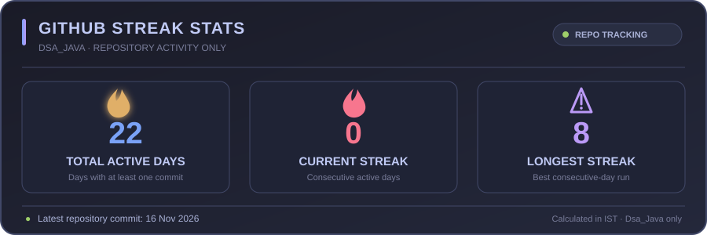

<!-- ===================== HERO ===================== -->

 

  

**A structured collection of my Data Structures and Algorithms practice in Java.**

*Understand the pattern. Build the logic. Optimize the solution.*

 

<a href="#-quick-navigation">Quick Navigation</a> ·
<a href="#-dsa-topic-wise-dashboard">Topic Dashboard</a> ·
<a href="./CODEFORCES_SOLUTIONS.md">Codeforces Dashboard</a> ·
<a href="#-coding-activity">Coding Activity</a>

---

## 🧭 Quick Navigation

| 🗂️ DSA Topic Dashboard | 🏁 Codeforces Dashboard | 📚 Complete DSA Index |
|:---:|:---:|:---:|
| Browse solutions by concept and pattern | Separate contest-wise problem tracker | Detailed learning roadmap and practice index |
| [**Explore Topics →**](#-dsa-topic-wise-dashboard) | [**Open Codeforces →**](./CODEFORCES_SOLUTIONS.md) | [**Open DSA Guide →**](./DSA_README.md) |

 

## 👨‍💻 About This Repository

This is my personal **Java DSA practice lab**. I use it to strengthen problem-solving fundamentals, recognize common algorithmic patterns, and prepare for technical interviews and coding assessments.

The repository brings together:

- **Topic-wise solutions** — problems grouped by the DSA concept they practise.
- **Optimization practice** — moving from a straightforward idea to an efficient solution.
- **Java implementations** — readable solutions using Java and its standard libraries.
- **Contest practice** — Codeforces submissions maintained in a separate dashboard.
- **Learning roadmap** — a broader structured checklist in the DSA guide.

## 📊 Repository Snapshot

| Area | Details |
|:---|:---|
| Primary language | Java 21 |
| Main focus | Data Structures and Algorithms |
| Practice style | Topic-wise and pattern-based |
| Problem sources | LeetCode, Codeforces and structured DSA practice |
| Codeforces index | [Dedicated dashboard](./CODEFORCES_SOLUTIONS.md) |
| Detailed learning guide | [DSA_README.md](./DSA_README.md) |

---

## 🧠 DSA Topic-Wise Dashboard

Browse the solutions by the main concept or problem-solving pattern. Each link opens the corresponding solution folder.

### 1. Arrays, Hashing & Prefix Patterns

| Problem | Core concept |
|:---|:---|
| [Contains Duplicate](./217-contains-duplicate) | HashSet |
| [Longest Consecutive Sequence](./128-longest-consecutive-sequence) | Hashing, sequence |
| [Find Subarrays With Equal Sum](./2480-find-subarrays-with-equal-sum) | Array traversal, hashing |
| [Merge Sorted Array](./88-merge-sorted-array) | Two arrays, in-place merge |
| [Intersection of Two Sorted Arrays](./706-intersection-of-two-sorted-arrays) | Two pointers |
| [Pascal's Triangle](./118-pascals-triangle) | Arrays, combinational pattern |

### 2. Two Pointers & Sliding Window

| Problem | Core concept |
|:---|:---|
| [Max Consecutive Ones III](./1046-max-consecutive-ones-iii) | Variable-size sliding window |
| [Longest Repeating Character Replacement](./424-longest-repeating-character-replacement) | Sliding window, frequency |
| [Minimum Window Substring](./76-minimum-window-substring) | Sliding window, character counts |

### 3. Binary Search & Search on Answer

| Problem | Core concept |
|:---|:---|
| [Binary Search](./792-binary-search) | Classic binary search |
| [Search Insert Position](./35-search-insert-position) | Lower-bound pattern |
| [Find First and Last Position](./34-find-first-and-last-position-of-element-in-sorted-array) | Boundary search |
| [Search in Rotated Sorted Array](./33-search-in-rotated-sorted-array) | Modified binary search |
| [Search in Rotated Sorted Array II](./81-search-in-rotated-sorted-array-ii) | Duplicates, binary search |
| [Find Peak Element](./162-find-peak-element) | Binary search on slope |
| [Single Element in a Sorted Array](./540-single-element-in-a-sorted-array) | Index parity |
| [Kth Missing Positive Number](./1646-kth-missing-positive-number) | Binary search on answer |
| [Median of Two Sorted Arrays](./4-median-of-two-sorted-arrays) | Binary search, partition |
| [Sqrt(x)](./69-sqrtx) | Binary search, integer answer |
| [Koko Eating Bananas](./907-koko-eating-bananas) | Minimum feasible answer |
| [Capacity to Ship Packages Within D Days](./1056-capacity-to-ship-packages-within-d-days) | Minimum capacity |
| [Find the Smallest Divisor](./1408-find-the-smallest-divisor-given-a-threshold) | Search on answer |
| [Split Array Largest Sum](./410-split-array-largest-sum) | Binary search on answer |

### 4. Dynamic Programming

| Problem | DP pattern |
|:---|:---|
| [Climbing Stairs](./70-climbing-stairs) | 1D DP |
| [House Robber](./198-house-robber) | Pick / not-pick |
| [House Robber II](./213-house-robber-ii) | Circular DP |
| [Unique Paths](./62-unique-paths) | Grid DP |
| [Unique Paths II](./63-unique-paths-ii) | Grid DP with obstacles |
| [Triangle](./120-triangle) | Variable-path grid DP |
| [Minimum Falling Path Sum](./967-minimum-falling-path-sum) | Falling-path DP |
| [Partition Equal Subset Sum](./416-partition-equal-subset-sum) | 0/1 Knapsack |
| [Count Good Numbers](./2050-count-good-numbers) | Counting, modular exponentiation |

### 5. Greedy Algorithms

| Problem | Greedy idea |
|:---|:---|
| [Assign Cookies](./455-assign-cookies) | Sort and match |
| [Jump Game](./55-jump-game) | Track farthest reachable index |
| [Lemonade Change](./890-lemonade-change) | Maintain useful change |
| [Best Time to Buy and Sell Stock](./121-best-time-to-buy-and-sell-stock) | Track minimum so far |

### 6. Recursion & Backtracking

| Problem | Core concept |
|:---|:---|
| [Generate Parentheses](./22-generate-parentheses) | Backtracking, valid choices |
| [Subsets](./78-subsets) | Include / exclude |

### 7. Math, Number Theory & Bitwise Thinking

| Problem | Core concept |
|:---|:---|
| [Palindrome Number](./9-palindrome-number) | Number manipulation |
| [Pow(x, n)](./50-powx-n) | Fast exponentiation |
| [Base 7](./504-base-7) | Base conversion |

### 8. Structured DSA Roadmap

| Resource | What it contains |
|:---|:---|
| [TUF A2Z Practice](./TUF-A2Z) | Topic-organized DSA learning and practice |

> **Note:** A problem can involve more than one pattern. It is placed under the concept that is most useful for learning its primary approach. The topic dashboard is a curated index; the automatically generated folder index below remains the repository-wide inventory.

---

## 🏁 Codeforces Contest Dashboard

Codeforces practice is intentionally kept separate from the topic-wise problem library. The dedicated page contains a unique list of Codeforces problems, their contest links, ratings, and Java solution links.

  

<a href="https://codeforces.com/profile/PrakashChakali12">Codeforces Profile: PrakashChakali12</a>

---

## 🔄 My Problem-Solving Workflow

For every problem, my target workflow is:

1. Understand the statement, constraints, and edge cases.
2. Think of a brute-force solution first.
3. Identify the pattern and improve the approach.
4. Write a clean Java implementation.
5. Evaluate time and space complexity.
6. Test with normal, boundary, and edge-case inputs.

## 🧰 Java & Developer Tools

## 📈 Coding Activity

 

---

## 📚 Complete Automatically Updated Problem Index

The topic dashboard above is curated for learning. This generated index is maintained by the repository workflow and lists qualifying problem folders as they are added.

<b>Expand complete generated problem list and latest LeetSync activity</b>

<!-- AUTO-README:START -->

## 📚 Automatically Updated Problems

**Total problem folders:** 41

<!-- Problem links are generated from folders containing Java files. -->

- [Max Consecutive Ones Iii](./1046-max-consecutive-ones-iii)
- [Capacity To Ship Packages Within D Days](./1056-capacity-to-ship-packages-within-d-days)
- [Pascals Triangle](./118-pascals-triangle)
- [Triangle](./120-triangle)
- [Best Time To Buy And Sell Stock](./121-best-time-to-buy-and-sell-stock)
- [Longest Consecutive Sequence](./128-longest-consecutive-sequence)
- [Find Peak Element](./162-find-peak-element)
- [Kth Missing Positive Number](./1646-kth-missing-positive-number)
- [House Robber](./198-house-robber)
- [Count Good Numbers](./2050-count-good-numbers)
- [House Robber Ii](./213-house-robber-ii)
- [Contains Duplicate](./217-contains-duplicate)
- [Generate Parentheses](./22-generate-parentheses)
- [Find Subarrays With Equal Sum](./2480-find-subarrays-with-equal-sum)
- [Search In Rotated Sorted Array](./33-search-in-rotated-sorted-array)
- [Find First And Last Position Of Element In Sorted Array](./34-find-first-and-last-position-of-element-in-sorted-array)
- [Search Insert Position](./35-search-insert-position)
- [Median Of Two Sorted Arrays](./4-median-of-two-sorted-arrays)
- [Split Array Largest Sum](./410-split-array-largest-sum)
- [Partition Equal Subset Sum](./416-partition-equal-subset-sum)
- [Longest Repeating Character Replacement](./424-longest-repeating-character-replacement)
- [Assign Cookies](./455-assign-cookies)
- [Powx N](./50-powx-n)
- [Base 7](./504-base-7)
- [Single Element In A Sorted Array](./540-single-element-in-a-sorted-array)
- [Jump Game](./55-jump-game)
- [Unique Paths](./62-unique-paths)
- [Unique Paths Ii](./63-unique-paths-ii)
- [Sqrtx](./69-sqrtx)
- [Climbing Stairs](./70-climbing-stairs)
- [Intersection Of Two Sorted Arrays](./706-intersection-of-two-sorted-arrays)
- [Minimum Window Substring](./76-minimum-window-substring)
- [Subsets](./78-subsets)
- [Binary Search](./792-binary-search)
- [Search In Rotated Sorted Array Ii](./81-search-in-rotated-sorted-array-ii)
- [Merge Sorted Array](./88-merge-sorted-array)
- [Lemonade Change](./890-lemonade-change)
- [Palindrome Number](./9-palindrome-number)
- [Koko Eating Bananas](./907-koko-eating-bananas)
- [Minimum Falling Path Sum](./967-minimum-falling-path-sum)
- [Tuf A2Z](./TUF-A2Z)

## 🔄 Latest Commit

- **Commit:** [`3d845a6`](https://github.com/Chakaliprakash/Dsa_Java/commit/3d845a64c8d545e02fd0c0110a144dafa410950f)
- **Problem:** [Find Subarrays With Equal Sum](./2480-find-subarrays-with-equal-sum)
- **Message:** Time: 1 ms (98.36%) | Memory: 43.2 MB (66.76%) - LeetSync
- **Date:** 2026-11-16T06:11:31+05:30

<!-- AUTO-README:END -->

## 🎯 Learning Goals

- [ ] Build strong fundamentals in arrays, strings, hashing, and recursion.
- [ ] Master binary search, sliding window, two pointers, and greedy patterns.
- [ ] Strengthen dynamic programming from recursion to space optimization.
- [ ] Practise contest problems consistently.
- [ ] Improve solution clarity and complexity analysis.

---

**One problem at a time. One pattern at a time. Continuous improvement.**

Maintained by **[ChakaliPrakash](https://github.com/Chakaliprakash)** · Java 21 · DSA Practice

